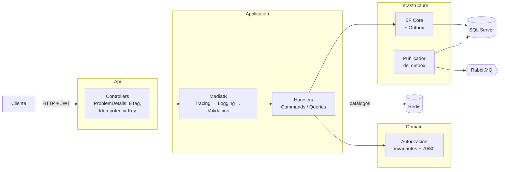
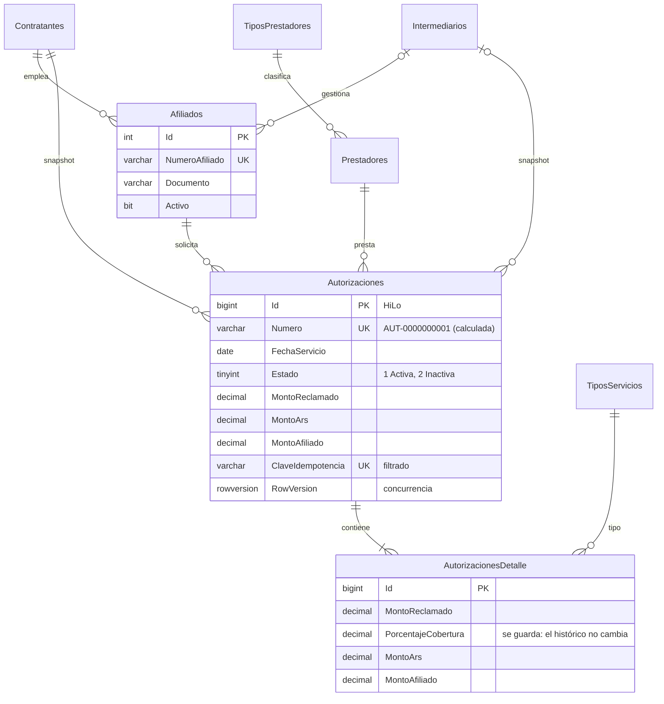

# HealthAuthorizations API

API REST para gestionar **autorizaciones de servicios de salud**: crear, actualizar, consultar (listado rápido y detalle) e inactivar, con distribución automática del monto entre la ARS y el afiliado (70 % / 30 %, configurable).

**.NET 10** · Clean Architecture · CQRS con MediatR · EF Core + SQL Server · JWT · OpenAPI/Scalar · Outbox + RabbitMQ · Redis · OpenTelemetry · Docker · Azure DevOps · SonarQube

| Calidad | |
|---|---|
| Pruebas | 207 (unitarias, arquitectura e integración con SQL Server y RabbitMQ reales) |
| Cobertura de líneas | 91 % |
| Duplicación (SonarQube) | 0,0 % · quality gate OK · 0 bugs · 0 vulnerabilidades |
| Imágenes (Trivy) | 0 vulnerabilidades HIGH/CRITICAL |

---

## Ejecutar

### Opción 1: todo en Docker (recomendada para evaluar)

Requisitos: Docker Desktop.

```bash
cp .env.example .env              # y reemplazar las claves (JWT_SIGNING_KEY: openssl rand -base64 48)
docker compose up -d --build
```

| Servicio | URL |
|---|---|
| API + documentación (Scalar) | http://localhost:8080/scalar |
| Salud | http://localhost:8080/health/ready |
| RabbitMQ (consola) | http://localhost:15672 (usuario y clave de `.env`) |
| Trazas, métricas y logs (Aspire) | http://localhost:18888 |

El servicio `migrator` crea o actualiza la base (esquema + catálogos de ejemplo) y termina; la API arranca después.

### Opción 2: API local con `dotnet run`

Requisitos: .NET SDK 10.0.404 (ver `global.json`) y Docker para las dependencias.

```bash
docker compose up -d sqlserver rabbitmq redis aspire-dashboard
cd src/HealthAuthorizations.Api
dotnet user-secrets set "ConnectionStrings:Default" "Server=localhost,1433;Database=HealthAuthorizations;User Id=sa;Password=<MSSQL_SA_PASSWORD>;TrustServerCertificate=True"
dotnet user-secrets set "Jwt:SigningKey" "$(openssl rand -base64 48)"
dotnet user-secrets set "Mensajeria:RabbitMq:Clave" "<RABBITMQ_PASSWORD>"
cd ../..
dotnet tool restore
dotnet ef database update -p src/HealthAuthorizations.Infrastructure -s src/HealthAuthorizations.Api
dotnet run --project src/HealthAuthorizations.Api      # http://localhost:5048/scalar
```

## Usar la API

1. **Obtener un token** (emisor de demostración, deshabilitado en producción):

   ```bash
   curl -X POST http://localhost:8080/api/v1/auth/token \
     -H "Content-Type: application/json" \
     -d '{"usuario":"operador","clave":"Operador.Demo.2026"}'
   ```

   | Usuario | Clave | Puede |
   |---|---|---|
   | `lector` | `Lector.Demo.2026` | consultar |
   | `operador` | `Operador.Demo.2026` | consultar, crear, actualizar e inactivar |

2. **Enviar** `Authorization: Bearer <accessToken>` en cada solicitud. En Scalar: botón *Authentication*.

La colección [`HealthAuthorizations.Api.http`](src/HealthAuthorizations.Api/HealthAuthorizations.Api.http) recorre el flujo completo (VS Code / Rider / Visual Studio). Apunta a `http://localhost:5048`; para Docker, cambiar `@host` a `http://localhost:8080`.

### Endpoints (`/api/v1`)

| Método | Ruta | Descripción |
|---|---|---|
| POST | `/auth/token` | Token de demostración |
| POST | `/autorizaciones` | Crear. Header opcional `Idempotency-Key`: un reintento devuelve la misma autorización |
| GET | `/autorizaciones` | Listado paginado por cursor; filtros por número, afiliado (id o documento), prestador, contratante, intermediario, tipo de servicio, estado y fechas |
| GET | `/autorizaciones/{id}` | Detalle con servicios y montos; devuelve `ETag` (304 con `If-None-Match`) |
| PUT | `/autorizaciones/{id}` | Actualizar; exige `If-Match` con el `ETag` (412 si cambió) |
| POST | `/autorizaciones/{id}/inactivacion` | Inactivar con motivo (no se borra: queda el histórico) |
| GET | `/catalogos/{afiliados,prestadores,contratantes,intermediarios,tipos-prestador,tipos-servicio}` | Catálogos |
| GET | `/health/live`, `/health/ready` | Sondas (anónimas) |

Los errores siguen **ProblemDetails (RFC 9457)** con un `code` estable y el `traceId` para ubicar el caso en los logs.

## Arquitectura



- **Domain** no depende de nada: el agregado `Autorizacion` protege sus reglas (≥ 1 servicio, montos no negativos, distribución, inactivación).
- **Application** contiene un handler por caso de uso. Consultas con proyección directa y paginación *keyset*.
- **Infrastructure** implementa persistencia, outbox, mensajería y caché.
- **Api** solo traduce HTTP ↔ casos de uso. Las reglas de dependencia se verifican con pruebas (NetArchTest).

### Modelo de datos



Además: `OutboxMessages` (eventos pendientes de publicar) y columnas de auditoría (`CreadoEn/Por`, `ModificadoEn/Por`) en todas las tablas.

## Pruebas y calidad

```bash
dotnet test                                                      # 207 pruebas (requiere Docker: Testcontainers)
dotnet test -- --coverage --coverage-output-format cobertura     # con cobertura
```

El pipeline [`azure-pipelines.yml`](azure-pipelines.yml) ejecuta en cada PR:
- build con warnings como errores;
- paquetes vulnerables;
- verificación de que las migraciones estén al día;
- pruebas;
- cobertura (mínimo 80 %);
- SonarQube.

En `main` también construye las imágenes, las escanea con Trivy y las publica.

## Documentación

| Documento | Contenido |
|---|---|
| [docs/guia-defensa.md](docs/guia-defensa.md) | Cómo explicar el proyecto: recorrido de una solicitud, reglas, preguntas frecuentes, cambios en vivo |
| [docs/decisiones-tecnicas.md](docs/decisiones-tecnicas.md) | 51 decisiones con alternativas y justificación |
| [docs/eventos-integracion.md](docs/eventos-integracion.md) | Contrato de eventos para sistemas consumidores |
| [database/README.md](database/README.md) | Migraciones y script SQL idempotente |
| [STATUS.md](STATUS.md) | Avance por fases y checklist de buenas prácticas |

## Estructura

```
src/
  HealthAuthorizations.Domain/          Agregado Autorizacion, catálogos, política de cobertura, eventos de dominio
  HealthAuthorizations.Application/     Casos de uso (Crear, Actualizar, Inactivar, Listar, Obtener), validadores, behaviors
  HealthAuthorizations.Infrastructure/  EF Core, migraciones, seed, outbox, RabbitMQ, health checks
  HealthAuthorizations.Api/             Controllers, seguridad, ProblemDetails, OpenAPI, observabilidad
tests/
  HealthAuthorizations.UnitTests/          Dominio, validadores, handlers
  HealthAuthorizations.IntegrationTests/   API completa contra SQL Server y RabbitMQ en contenedores
  HealthAuthorizations.ArchitectureTests/  Reglas de dependencia entre capas
database/          Script SQL idempotente
docs/              Documentación
Dockerfile         Imágenes api y migrator
docker-compose.yml Entorno local completo
```
